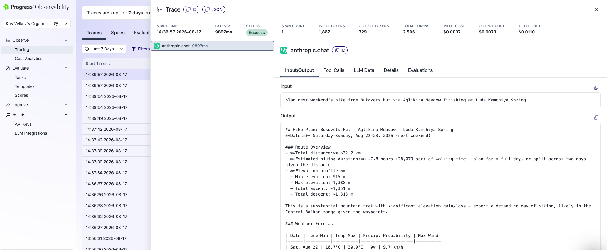
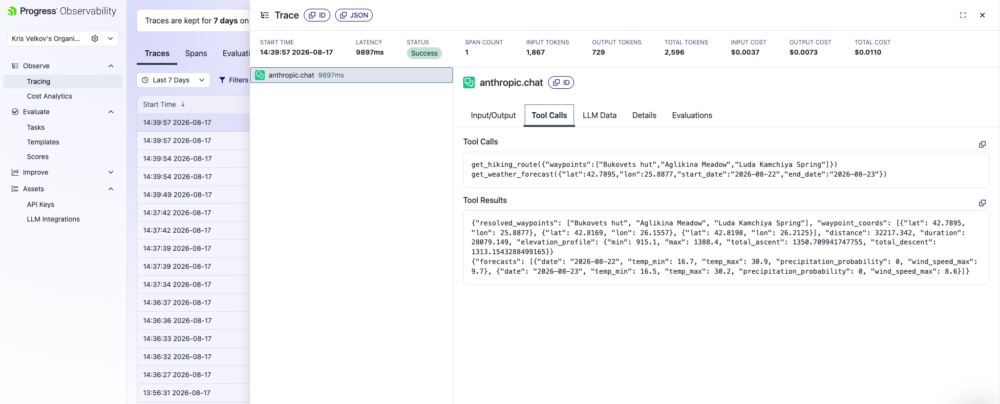
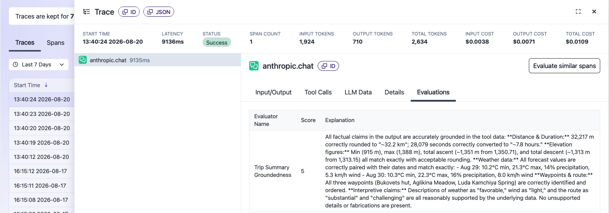
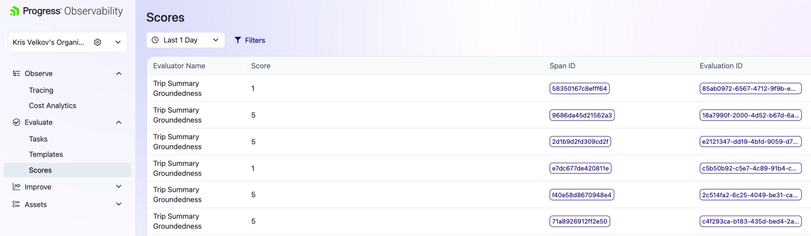

# Hike Planner Agent

An AI agent that plans multi-day hiking trips across Bulgaria's mountain ranges (Rila, Pirin, Rhodopes, Stara Planina), combining route/elevation data with weather forecasting — built as a portfolio project to demonstrate AI agent development and observability instrumentation.

## What it does

Given a natural-language request (e.g. *"plan next weekend's hike from Bukovets hut via Aglikina Meadow finishing at Luda Kamchiya Spring"*), the agent:

1. Resolves each named location and calculates a foot-hiking route through them in order, including distance, estimated duration, and elevation profile (min/max elevation, total ascent/descent).
2. Checks the weather forecast for the trip's date range against the route's actual starting location.
3. Produces a plain-language trip summary, flagging any weather conditions (heat, rain, wind) that could affect the hike.

## Architecture

- **`main.py`** — the agent loop, built on the Anthropic Python SDK's tool-use API. Claude decides which tools to call and in what order, based on the system prompt's instructions (route first, then weather using the route's resolved coordinates).
- **`tools/routing.py`** — route + elevation via GraphHopper's Directions API. Geocoding uses a curated `KNOWN_LOCATIONS` lookup table as the primary source, falling back to GraphHopper's geocoding API for anything not in the table.
- **`tools/weather.py`** — daily forecast via Open-Meteo (free, no API key).
- **Observability** — instrumented with [Progress AI Observability](https://www.telerik.com/ai-observability-platform) (free tier), tracing every LLM call, tool invocation, latency, and token usage.

## Setup

```bash
python3 -m venv venv
source venv/bin/activate
pip install -r requirements.txt
cp .env.example .env  # then fill in your real API keys
```

Required keys in `.env`:
- `ANTHROPIC_API_KEY` — Anthropic Console (pay-as-you-go)
- `GRAPHHOPPER_API_KEY` — free tier at graphhopper.com
- `OBSERVABILITY_APP_NAME` / `OBSERVABILITY_API_KEY` — Progress AI Observability, free tier

## Running it

```bash
python3 main.py "plan a two-day hike from Malyovitsa Hut to Ivan Vazov Hut this weekend"
```

Or run with no argument for a default test prompt.

## Design decisions worth noting

**Mid-build provider outage.** The project was originally built on OpenRouteService. Partway through, ORS's Directions API began rejecting a valid, unexpired key with a 403 error — confirmed via direct API testing to be an account-side issue on their end (not a code or quota problem), matching an unresolved report on ORS's own community forum. Rather than block on a third-party fix, the routing/elevation logic was migrated to GraphHopper's equivalent free-tier API, with the ORS integration documented and kept as a reference in case service is restored.

**Geocoding accuracy.** General-purpose geocoders (tested across two independent providers) proved unreliable for short, ambiguous alpine place names — a hut name resolved to a nearby peak; a Bulgarian summit name resolved to an unrelated peak in Pakistan, even with regional bias applied. Rather than fight query tuning indefinitely, the project uses a small curated `KNOWN_LOCATIONS` table as the trusted source for places actually tested, treating the live geocoding API as a best-effort fallback only. This tradeoff — curated accuracy over API-only coverage — was a deliberate choice given the project's narrow, known domain (a specific hiker's regular routes) rather than general-purpose travel planning.

## Observability

Screenshots of instrumented traces (tool calls, latency, token usage) from the Progress AI Observability dashboard:




## Evaluations

Two LLM-as-a-judge evaluation tasks are configured in Progress AI Observability to score agent output quality against the underlying tool data, using `claude-haiku-4-5-20251001` as the judge model:

- **Trip Summary Groundedness** — checks whether every factual claim in the agent's final summary (distance, elevation, ascent/descent, per-day forecast figures) matches the raw tool data it was based on, scored 1-5.
- **Weather Risk Flagging** — checks whether the summary proportionately surfaces real weather hazards (high precipitation probability, strong wind, heat combined with significant ascent, cold exposure) against defined thresholds applied to the forecast data, scored 1-5.

Both prompts are written against the trace's tool call data, not just the final text — a judge comparing output to the original user request alone can't catch factual drift from the actual numbers, only whether the response sounds plausible.

**Evidence — a passing trace, scored 5/5:**


*A full trace showing the Trip Summary Groundedness evaluator's explanation: every distance, elevation, and weather figure cross-checked against the tool output and confirmed accurate.*

**Evidence — score distribution across multiple runs:**


*Scores across six evaluated spans show real variance (two scored 1, four scored 5) rather than a flat default score — evidence the judge is actually discriminating between grounded and ungrounded outputs, not rubber-stamping every run.*

## Status

v1 scope complete: point-to-point and multi-waypoint routing, elevation profile, weather forecast, full observability instrumentation. Not yet built: open-area route discovery (e.g. "somewhere in Pirin" without named waypoints) — scoped out of v1 as a heavier build requiring OpenStreetMap trail-discovery queries.